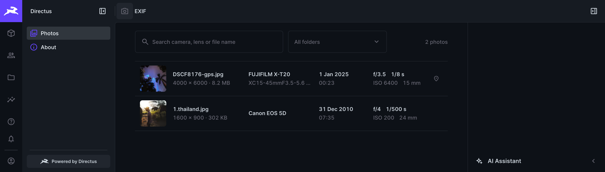
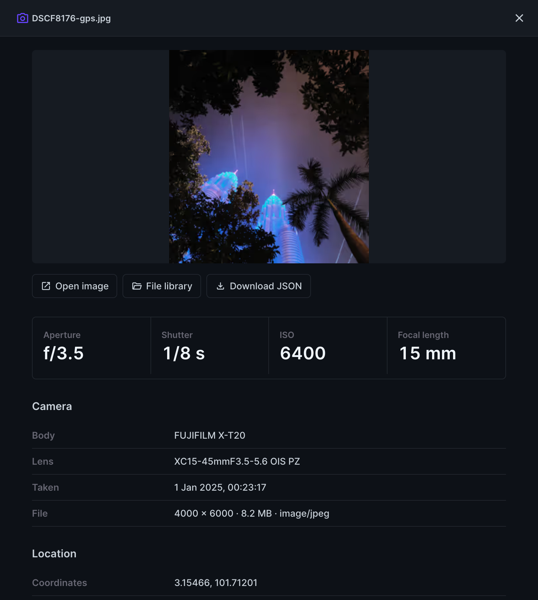
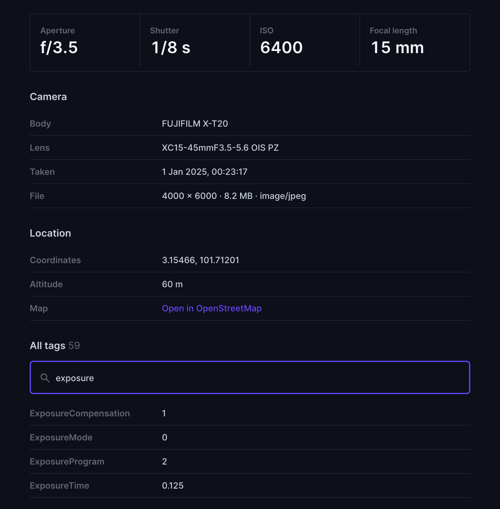
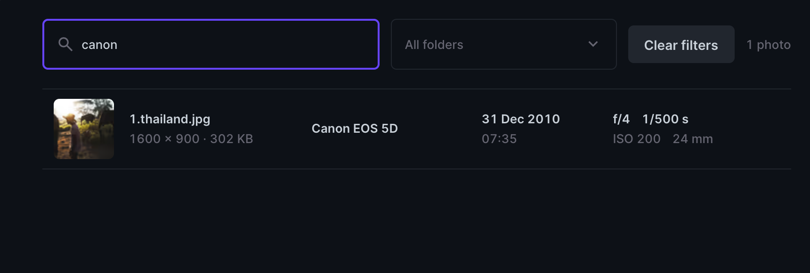
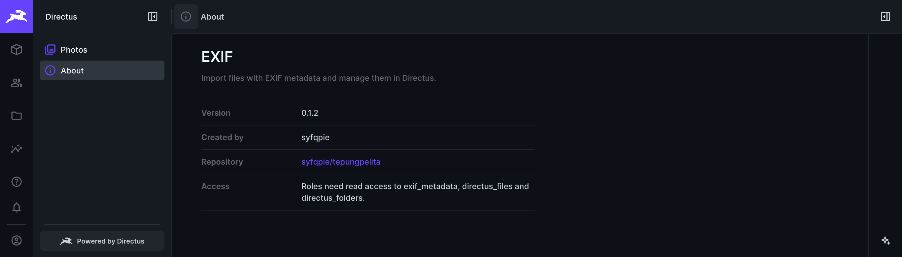

<p align="center">
  
</p>

<h1 align="center">@tepungpelita/directus-exif-extension</h1>

<p align="center">
  See the camera, lens, settings and location behind every photo in your Directus file library.
</p>

<p align="center">
  
</p>

This Directus extension reads the EXIF metadata of every image you upload, stores it next to the file in an `exif_metadata` collection, and adds an **EXIF** module to the admin where you can browse, search and inspect it.

- **Automatic.** Upload or replace an image and its EXIF is stored. Nothing to configure.
- **An EXIF module in the admin.** A photo list with thumbnails, a details drawer with every tag, search and a folder filter.
- **Queryable from your code.** One regular collection, linked one-to-one with `directus_files`.

## Using the EXIF module

Turn the module on once: **Settings → Settings → Module Bar**, switch **EXIF** on and save. Directus does not add new modules to a module bar you have already customized.

### 1. Photos

Choose **EXIF** in the module bar, then **Photos** in the sidebar. You see one row per photo, newest first: thumbnail, file name and size, camera and lens, date and time taken, the main exposure settings, and a pin if the photo has GPS.

### 2. Click a photo for everything we know about it

A drawer opens with the exposure readout (aperture, shutter, ISO, focal length), camera body, lens and date taken, the GPS position with a link to OpenStreetMap, and **every stored tag** with a filter box. **Open image**, **File library** and **Download JSON** sit above the readout. Press `Esc` to close it.

<p align="center">
  
  
</p>

### 3. Find photos

- **Search** matches the camera make, camera model, lens, file name and title, ignoring case.
- **Folder** narrows the list to a file library folder, including its subfolders.

Both filters work across every page of results.

<p align="center">
  
</p>

### 4. Export

- **Download JSON** (in the drawer) saves one photo with all its tags.
- For many photos at once, use Directus's own export: **Content → Exif Metadata → Import / Export**.

> Exports contain GPS coordinates when a photo has them. Treat them like the photos themselves.

### 5. About

**About** in the sidebar shows the version, who made the extension and where the source lives.

<p align="center">
  
</p>

### Who can see it

The EXIF entry is shown only to administrators and to roles that can read `exif_metadata`. Those roles also need **Read** on `directus_files` and `directus_folders`; without them the page shows a "No access" message.

## How it works

The bundle contains a hook, `exif-import` (`src/hooks/exif-import`), and the **EXIF** module (`src/modules/exif`). The hook does the work:

1. **Provisioning** — on `app.after` it creates the `exif_metadata` collection and its relation to `directus_files` if they don't exist (definition in `schemas/exif-metadata.ts`).
2. **Import** — on `files.upload` it reads the uploaded image from disk, parses it with [`exifr`](https://github.com/MikeKovarik/exifr), and creates or updates the `exif_metadata` row for that file.

Only JPEG, PNG, TIFF, HEIC and AVIF images are read (`exifr` can't parse WebP or GIF); other files and images without EXIF data are skipped. Errors are logged and never block the upload.

The module only reads the collection through the normal Directus items API, so it follows your roles and permissions and needs no extra server code.

## Collection: `exif_metadata`

| Field                                       | Type                                                     | Source EXIF tag                          |
| ------------------------------------------- | -------------------------------------------------------- | ---------------------------------------- |
| `file`                                      | uuid (m2o → `directus_files`, unique, cascade on delete) | —                                        |
| `camera_make`, `camera_model`, `lens_model` | string                                                   | `Make`, `Model`, `LensModel`             |
| `date_taken`                                | timestamp                                                | `DateTimeOriginal` / `CreateDate`        |
| `orientation`                               | integer                                                  | `Orientation`                            |
| `iso`                                       | integer                                                  | `ISO`                                    |
| `focal_length`, `aperture`, `exposure_time` | decimal                                                  | `FocalLength`, `FNumber`, `ExposureTime` |
| `gps_latitude`, `gps_longitude`             | decimal                                                  | GPS (decimal degrees)                    |
| `gps_altitude`                              | decimal                                                  | `GPSAltitude`                            |
| `raw`                                       | json                                                     | Full parsed EXIF payload                 |

The collection is created automatically by the hook on startup; no migration is needed.

## Querying via the API

`exif_metadata` is a regular collection, so use the standard items endpoints. The authenticated role needs read permission on `exif_metadata`.

```bash
# EXIF for one file
curl -H "Authorization: Bearer $TOKEN" \
  "$DIRECTUS_URL/items/exif_metadata?filter[file][_eq]=<file-id>&limit=1"

# Photos taken with a given camera, newest first, with the related file info
curl -H "Authorization: Bearer $TOKEN" \
  "$DIRECTUS_URL/items/exif_metadata?filter[camera_make][_eq]=Canon&sort=-date_taken&fields=id,camera_model,date_taken,file.id,file.filename_download"

# Only photos that have GPS coordinates
curl -H "Authorization: Bearer $TOKEN" \
  "$DIRECTUS_URL/items/exif_metadata?filter[gps_latitude][_nnull]=true&fields=file,gps_latitude,gps_longitude"
```

With the SDK:

```ts
import { createDirectus, rest, readItems } from '@directus/sdk'

const client = createDirectus(DIRECTUS_URL).with(rest())
const items = await client.request(
  readItems('exif_metadata', { filter: { file: { _eq: fileId } }, limit: 1 }),
)
```

## Installation

Search for **Directus Exif Extension** in the Directus Marketplace (Settings → Marketplace), or install from npm:

```bash
npm install @tepungpelita/directus-exif-extension
```

This hook reads files from disk and uses Directus services, so it is not a sandboxed extension. On self-hosted instances, set `MARKETPLACE_TRUST=all` (or trust this package) to install it from the Marketplace.

## Requirements

- Directus `>=11.0.0` (developed and tested on 12; the module's styling uses the theme variables introduced in 11)
- Files stored on the **local** storage driver (the default). The hook reads the file from the location's `STORAGE_<LOCATION>_ROOT` (default `./uploads`); files on other drivers are skipped with a warning.

## Development

From the repo root:

```bash
pnpm --filter @tepungpelita/directus-exif-extension build   # or: pnpm build
pnpm docker:restart:directus
```

Upload a JPEG with EXIF data in the Directus file library, then open **EXIF** in the module bar (see above to turn it on).

The shared formatting helpers live in the private `packages/exif-ui-core` workspace package and are bundled into the build.
