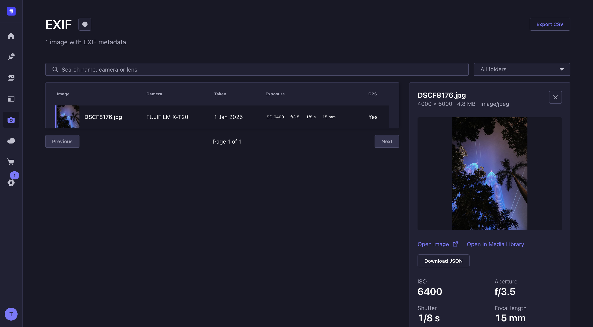
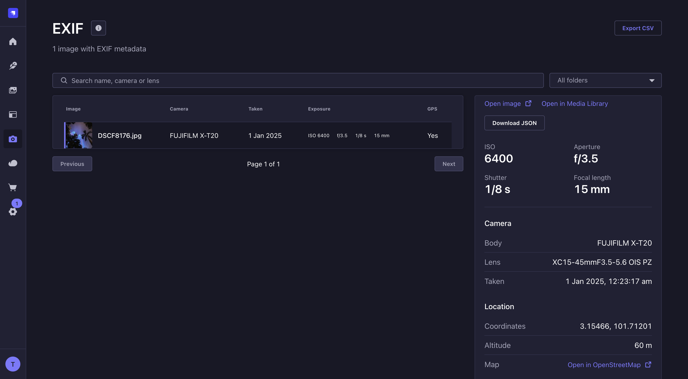
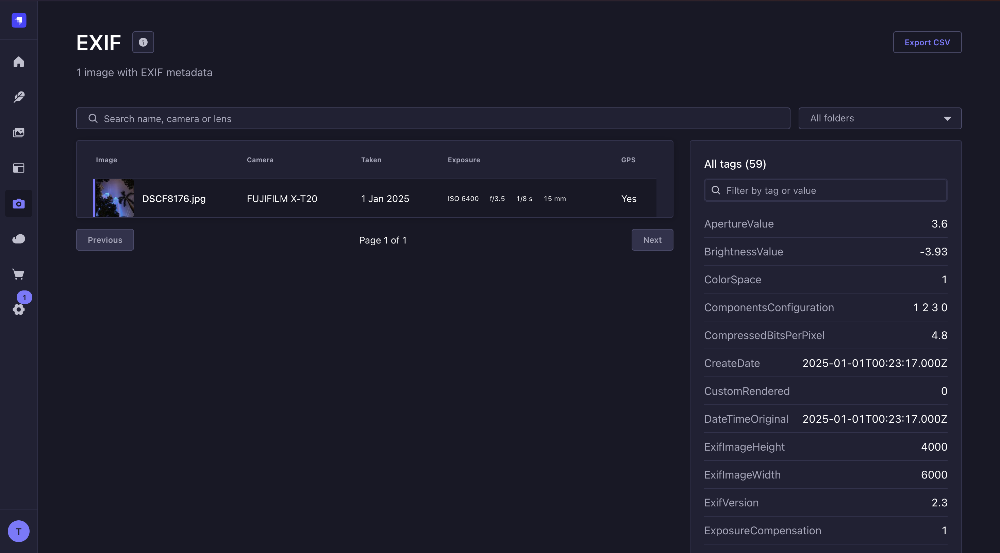
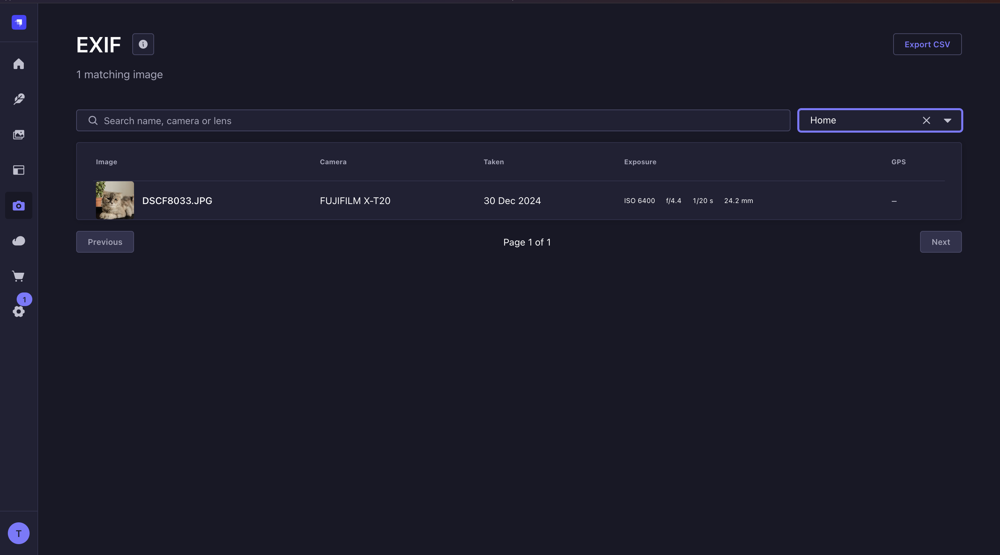
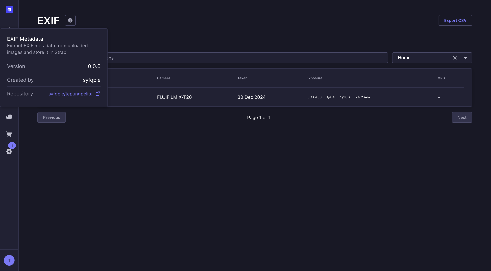

<h1 align="center">@tepungpelita/strapi-exif-plugin</h1>

<p align="center">
  See the camera, lens, settings and location behind every photo in your Strapi media library.
</p>

<p align="center">
  
</p>

This Strapi 5 plugin reads the EXIF metadata of every image you upload, stores it next to the file, and adds an **EXIF** page to the admin where you can browse, search and export it.

- **Automatic.** Upload or replace an image and its EXIF is stored. Nothing to configure.
- **Works with Strapi's image optimization.** Strapi re-encodes uploads and drops their EXIF. The plugin reads the original first, so the data survives.
- **An EXIF page in the admin.** A list with thumbnails, a details panel with every tag, search, a folder filter, and CSV and JSON export.
- **Queryable from your code.** One collection, `plugin::exif.exif-metadata`, linked to the media file.

## Install

```bash
npm install @tepungpelita/strapi-exif-plugin
```

Strapi finds the plugin by itself; there is no config to write. Then:

- **Development:** restart `strapi develop`. It rebuilds the admin and the **EXIF** entry appears in the menu.
- **Production:** run `strapi build` so the admin panel includes the new page, then start Strapi.

Requires Strapi `^5`. See [Limitations](#limitations) for upload providers.

## Using it

### 1. Upload photos

Add photos in the **Media Library** as usual. Each image with EXIF data gets an entry. Replacing a photo refreshes its entry, and deleting a photo removes it.

### 2. Open the EXIF page

Choose **EXIF** in the admin menu. You see one row per photo, newest first: thumbnail, camera, date taken, the four main exposure settings, and whether it has GPS.

<p align="center">
  
</p>

### 3. Click a photo for everything we know about it

A panel opens beside the list with:

- the exposure readout: ISO, aperture, shutter speed and focal length
- camera body, lens and when the photo was taken
- the GPS position, with a link to OpenStreetMap
- **every stored tag**, with a filter box
- links to open the image and to jump to it in the Media Library
- **Download JSON** for that photo's complete data

Press `Esc` or the close button to go back to the list.

<p align="center">
  
  
</p>

### 4. Find photos

- **Search** matches the file name, camera make, camera model and lens, ignoring case.
- **Folder** narrows the list to a Media Library folder, including its subfolders. It appears once you have at least one folder.

Both filters work across every page of results, not only the one you are looking at.

<p align="center">
  
</p>

### 5. Export

- **Export CSV** (top right) saves one line per photo for everything that matches the current search and folder: file, image URL, camera, lens, taken, ISO, aperture, shutter, focal length and GPS.
- **Download JSON** (in the details panel) saves one photo with all its tags.

> Exports contain GPS coordinates when a photo has them. Treat them like the photos themselves.

### 6. About

The **i** button next to Export CSV shows the plugin version, who made it and where the source lives.

<p align="center">
  
</p>

## What gets stored

One entry per image, in the `exif-metadata` collection (UID `plugin::exif.exif-metadata`):

| Field                                        | Type     | Comes from                                         |
| -------------------------------------------- | -------- | -------------------------------------------------- |
| `file`                                       | relation | one-to-one with the Media Library file             |
| `cameraMake`, `cameraModel`, `lensModel`     | string   | `Make`, `Model`, `LensModel`                       |
| `dateTaken`                                  | datetime | `DateTimeOriginal`, or `CreateDate` if missing     |
| `orientation`, `iso`                         | integer  | `Orientation`, `ISO`                               |
| `focalLength`, `aperture`, `exposureTime`    | float    | `FocalLength`, `FNumber`, `ExposureTime` (seconds) |
| `gpsLatitude`, `gpsLongitude`, `gpsAltitude` | float    | GPS, in decimal degrees and metres                 |
| `raw`                                        | json     | every tag that was parsed, as numeric EXIF codes   |

Good to know:

- **`dateTaken` is the camera's clock.** EXIF times have no timezone, so the plugin stores the time exactly as the camera wrote it. It looks the same on every server and the admin shows it as stored.
- **`raw` uses the standard numeric codes**, for example `Flash: 0` and `Orientation: 6`, not translated text.
- **The collection is hidden from the Content Manager.** The plugin writes the entries, so there is nothing to edit by hand.

## Supported images

| Read                        | Not read                                                   |
| --------------------------- | ---------------------------------------------------------- |
| JPEG, PNG, TIFF, HEIC, AVIF | WebP, GIF, SVG and other files (skipped without a message) |

An image that has no EXIF is not listed. If you replace a photo with one that has none, the old entry is removed so it can never show the previous photo's location.

## Privacy and permissions

- **Who can see it:** the EXIF page needs the same permission as the Media Library (`Read`). Admins without it see a message instead of data. The page uses its own admin route, so it does not depend on Content Manager permissions.
- **GPS is stored.** Anyone who can open the EXIF page can see where a photo was taken.
- **What visitors get:** with Strapi's default image optimization the file served to visitors is normally re-encoded without EXIF. The plugin keeps a copy of the metadata in the database, not in the file.
- **Nothing leaves your server.** The only external link is the optional OpenStreetMap link, which opens only when you click it.

## Reading the data in your code

The collection has no public REST endpoint. Read it from your own server code with Strapi's database layer:

```js
// in a controller, service or bootstrap
const entries = await strapi.db.query("plugin::exif.exif-metadata").findMany({
  where: { cameraMake: { $containsi: "fuji" } },
  populate: { file: true },
  orderBy: { dateTaken: "desc" },
  limit: 20,
});
```

If you need to expose it to a front end, wrap a query like this in your own controller and route, and decide there who may call it.

### Admin API

The EXIF page is served by these admin routes. They need an admin login and `Read` on the Media Library, and they are not meant for API tokens.

| Route                                                       | Returns                                                         |
| ----------------------------------------------------------- | --------------------------------------------------------------- |
| `GET /exif/images?page=1&pageSize=20&search=x-t20&folder=3` | `{ results, pagination: { page, pageSize, pageCount, total } }` |
| `GET /exif/folders`                                         | `{ results: [{ id, pathId, name, path }] }`                     |

`pageSize` is at most 100. `folder` is a Media Library folder id and includes its subfolders.

## Troubleshooting

**The log says `no EXIF data found for file 12`.** That file really has no EXIF. Screenshots, and images saved from social networks or photo sites, are stripped of it. Check the original file.

**Photos I uploaded before installing the plugin are not listed.** EXIF is read when a file is uploaded or replaced. Re-upload the original, or use **Replace media** with it. Copies that Strapi already re-encoded no longer contain EXIF, so nothing can be recovered from them.

**A WebP or GIF shows nothing.** Those formats carry no EXIF that this plugin can read.

**The EXIF page says I don't have permission.** Ask an admin to give your role `Read` on the Media Library (Settings, Administration panel, Roles).

**The EXIF menu entry is missing.** Rebuild the admin (`strapi build`, or restart `strapi develop`) and refresh the browser.

## Limitations

- **Tested with the local upload provider.** The plugin reads each file as it is uploaded, and for files it did not see being uploaded it reads them from local disk. On a cloud provider, uploads that Strapi optimizes should still work, but this has not been tested.
- **No backfill yet.** Existing media is not scanned; see the troubleshooting entry above.
- **Strapi 5 only.**

## Development

This plugin lives in the [tepungpelita monorepo](https://github.com/syfqpie/tepungpelita). From the repo root:

```bash
pnpm install
pnpm dev                  # rebuilds the plugin on every save
pnpm docker:up:strapi     # a dev Strapi at http://localhost:1337
pnpm docker:restart:strapi
```

Wait for the watcher to finish building before restarting Strapi. See the [repository README](https://github.com/syfqpie/tepungpelita#readme) for details.

## Credits and license

EXIF parsing by [exifr](https://github.com/MikeKovarik/exifr). MIT licensed.
